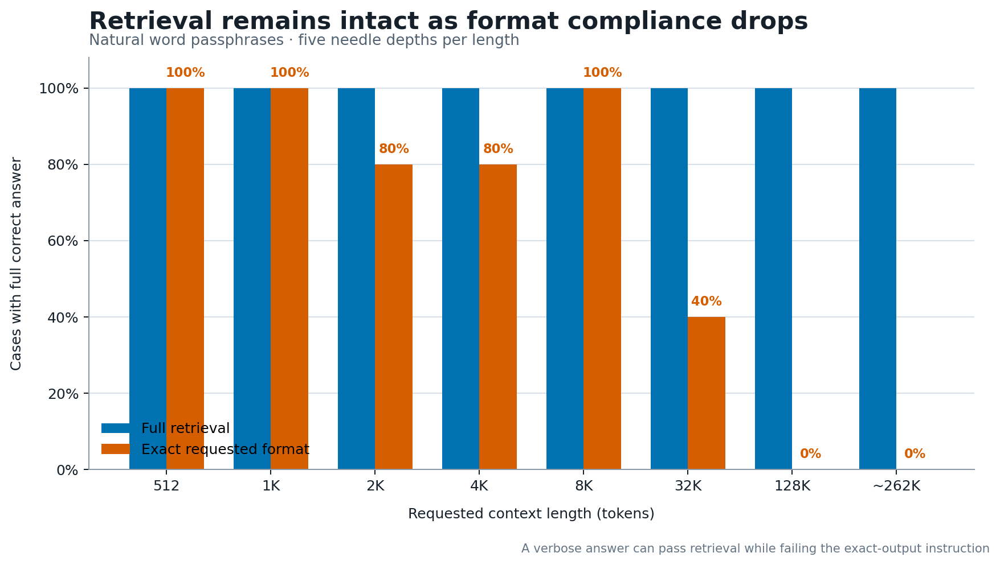
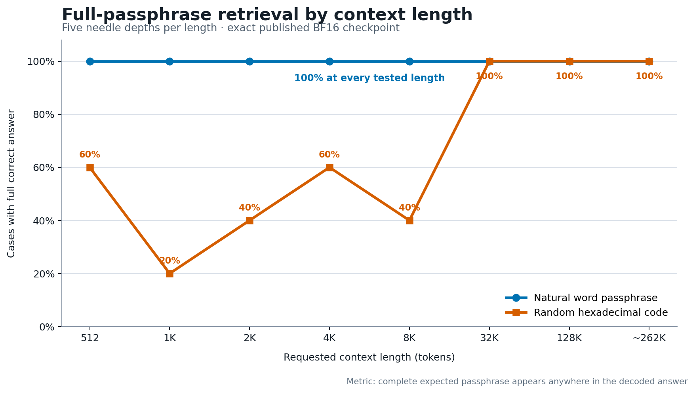

# OELLM 9B 256K SFT

Experimental instruction-tuned checkpoint derived from
[`openeurollm/oellm-9b-256k-theta64m-prelude`](https://huggingface.co/openeurollm/oellm-9b-256k-theta64m-prelude).
It is the first SFT stage of an OpenEuroLLM post-training experiment on LUMI. The base is a dense
Qwen3 9B model using the independent OpenEuroLLM 256K tokenizer and a 262,144-token context
configuration.

This repository contains the SFT model, not the subsequent SimPO model.

## Intended use and interpretation

The purpose of this checkpoint is to test whether short-sequence instruction tuning can add useful
chat behavior while retaining the base model's long-context capability. It is **not** presented as
a reasoning-specialized model. The 262,144-token configuration describes the maximum input length
accepted by the architecture; it does not, by itself, establish accurate retrieval at that length.

## Usage

```python
import torch
from transformers import AutoModelForCausalLM, AutoTokenizer

model_id = "openeurollm/oellm-9b-256k-sft"
tokenizer = AutoTokenizer.from_pretrained(model_id)
model = AutoModelForCausalLM.from_pretrained(
    model_id,
    dtype=torch.bfloat16,
    device_map="auto",
).eval()

messages = [{"role": "user", "content": "Förklara allemansrätten kort på svenska."}]
inputs = tokenizer.apply_chat_template(
    messages,
    add_generation_prompt=True,
    return_tensors="pt",
    return_dict=True,
).to(model.device)

with torch.inference_mode():
    output = model.generate(
        **inputs,
        max_new_tokens=256,
        eos_token_id=tokenizer.eos_token_id,
        pad_token_id=tokenizer.pad_token_id,
    )
print(tokenizer.decode(output[0, inputs["input_ids"].shape[1]:], skip_special_tokens=True))
```

Long-context inference, especially near 256K, requires multiple GPUs for the KV cache. Keep
`max_position_embeddings=262144` and `rope_theta=64000000` unchanged.

## Training

| Field | Value |
|---|---|
| Base | `openeurollm/oellm-9b-256k-theta64m-prelude` |
| Training library | Hugging Face TRL 0.28.0, using `SFTTrainer` and `SFTConfig` through a text-only wrapper |
| Method | Full-parameter BF16 supervised fine-tuning; no LoRA or other PEFT adapter |
| Distributed stack | Accelerate FSDP `FULL_SHARD`, FlashAttention 2, gradient checkpointing |
| Framework versions | Transformers 5.12.1; PyTorch 2.9.1+ROCm 6.4; Datasets 5.0.0; Tokenizers 0.22.2 |
| Data | 920,552 Tulu-3 rows + 161,644 EuroBlocks rows + a 250,000-row Nemotron-v2 math prefix |
| Loaded examples | 1,332,196 source conversations before tokenization and packing |
| Tokenized corpus | 2,593,634,710 tokens before training-time sampling |
| Sequence construction | Maximum length 4,096; best-fit-decreasing packing; 635,974 packed sequences at 99.57% mean fill |
| Loss | Standard causal NLL over the full rendered conversation; `assistant_only_loss=false` |
| Steps | 3,000 (about 0.604 epoch) |
| Global batch | 128 packed sequences (32 ranks × batch 1 × gradient accumulation 4) |
| Optimizer schedule | Fused AdamW, peak LR 6e-6, cosine decay, 3% warmup, weight decay 0, gradient clipping 1.0 |
| Randomness | Random train sampler, seed 42; no held-out validation split |
| Hardware | 4 LUMI-G nodes, 32 AMD MI250X GCDs |
| Runtime | 14h 36m |
| Tokens processed | 1,566,026,219 |
| Training loss | 0.8034 aggregate; 0.7671 in the final 20-step logging window |
| Final logged mean token accuracy | 0.7839 |

The published weights are an unquantized BF16 export of the consolidated training checkpoint.
The framework versions above come from the trainer-generated README stored with the completed
checkpoint; the remaining values were checked against the submitted YAML, serialized `SFTConfig`,
Slurm accounting, trainer state, logs, and cached Arrow datasets for LUMI job `20290451`.

## Training-data composition

The counts below were reconstructed from the exact YAML, source JSONL files, and Parquet metadata
used by LUMI job `20290451`. They are effective row counts for this run, rather than nominal counts
copied from upstream dataset cards.

### Effective mixture

| Effective training slice | Rows | Share | Role in the run |
|---|---:|---:|---|
| Staged [`allenai/tulu-3-sft-mixture`](https://huggingface.co/datasets/allenai/tulu-3-sft-mixture) commercial subset | 920,552 | 69.10% | General instruction replay, predominantly English but with multilingual rows in several components |
| Staged [`utter-project/EuroBlocks-SFT-Synthetic-1124`](https://huggingface.co/datasets/utter-project/EuroBlocks-SFT-Synthetic-1124) subset | 161,644 | 12.13% | Synthetic European-language instruction following |
| First 250,000 rows of the staged [`nvidia/Nemotron-Post-Training-Dataset-v2`](https://huggingface.co/datasets/nvidia/Nemotron-Post-Training-Dataset-v2) math file | 250,000 | 18.77% | English math prompts with synthetic `<think>` reasoning traces and boxed answers |
| **Total** | **1,332,196** | **100%** | Source conversations loaded before tokenization and packing |

The first two slices form the 1,082,196-row *general* Parquet. Within that Parquet the ratio is
85.06% Tulu to 14.94% EuroBlocks, which explains the staging-directory name
`tulu3-euroblocks-85-15`. Adding the reasoning slice changes the overall ratio to the one shown
above. These are row shares, not token shares.

### Tokenized mixture

Row shares substantially understate the contribution of the long Nemotron reasoning traces. The
exact token counts below were measured from the tokenized Arrow cache produced by the training job,
before best-fit-decreasing packing and random training-time sampling:

| Effective training slice | Rows | Row share | Tokens | Token share | Mean tokens/row |
|---|---:|---:|---:|---:|---:|
| Tulu-3 commercial subset | 920,552 | 69.10% | 841,791,947 | 32.46% | 914 |
| EuroBlocks subset | 161,644 | 12.13% | 81,355,816 | 3.14% | 503 |
| Nemotron-v2 math prefix | 250,000 | 18.77% | 1,670,486,947 | 64.41% | 6,682 |
| **Total** | **1,332,196** | **100%** | **2,593,634,710** | **100%** | **1,947** |

Packing preserved all 2,593,634,710 tokens in 635,974 sequences. The run sampled 384,000 packed
sequences over 3,000 optimizer steps and processed 1,566,026,219 tokens, corresponding to 0.6038
epoch. Because source identities are not retained after cross-example packing, the table describes
the exact tokenized pool rather than an exact per-source count of tokens drawn by the random sampler.

### Tulu-3 subset: exact source counts

The run did not load the current public Tulu-3 mixture wholesale. It used a locally staged file
named `tulu3-commercial.jsonl` with 920,552 rows. Its preserved `source` field gives the following
breakdown; raw source identifiers are shown to avoid silently relabeling the data:

| Tulu source identifier | Rows |
|---|---:|
| `ai2-adapt-dev/personahub_math_v5_regen_149960` | 148,492 |
| `ai2-adapt-dev/evol_codealpaca_heval_decontaminated` | 106,173 |
| `ai2-adapt-dev/tulu_v3.9_wildchat_100k` | 99,031 |
| `ai2-adapt-dev/tulu_v3.9_aya_100k` | 98,991 |
| `ai2-adapt-dev/flan_v2_converted` | 89,062 |
| `ai2-adapt-dev/numinamath_tir_math_decontaminated` | 63,667 |
| `allenai/tulu-3-sft-personas-math-grade` | 49,504 |
| `ai2-adapt-dev/tulu_v3.9_open_math_2_gsm8k_50k` | 49,498 |
| `ai2-adapt-dev/tulu_v3.9_wildjailbreak_decontaminated_50k` | 49,491 |
| `ai2-adapt-dev/tulu_v3.9_synthetic_finalresp_wildguardmixtrain_decontaminated_50k` | 49,465 |
| `ai2-adapt-dev/personahub_code_v2_34999` | 34,657 |
| `ai2-adapt-dev/personahub_ifdata_manual_seed_v3_29980` | 29,678 |
| `ai2-adapt-dev/tulu_v3.9_personahub_math_interm_algebra_20k` | 19,798 |
| `ai2-adapt-dev/coconot_converted` | 10,894 |
| `ai2-adapt-dev/tulu_v3.9_sciriff_10k` | 9,895 |
| `ai2-adapt-dev/oasst1_converted` | 7,063 |
| `ai2-adapt-dev/tulu_v3.9_table_gpt_5k` | 4,957 |
| `ai2-adapt-dev/tulu_hard_coded_repeated_10` | 236 |
| **Total** | **920,552** |

The non-commercial No Robots component listed by the full Tulu-3 card is not present in this staged
file. The staging label `commercial` describes the selected artifact; users should still review the
Tulu collection license and every component's terms. The file has no normalized language column, so
we do not infer exact per-language counts for this slice from prompt text.

### EuroBlocks subset: retained provenance

The 161,644 effective rows have synthetic IDs from `EuroBlocks-SFT-Synthetic-1124_1` through
`_161644`. This is smaller than the 340,286-line EuroBlocks staging file present on LUMI. The final
training Parquet retains only `{id, messages}` and the source staging JSONL retains only `messages`;
neither artifact records a normalized language label or the sampling/filtering mapping from the
340,286-row source to the 161,644-row effective subset. Exact per-language counts therefore cannot
be reconstructed from the frozen training artifacts without running a new language-identification
pass. EuroBlocks is synthetic and its dataset card documents mixed upstream sources and terms.

### Reasoning slice: what was actually selected

The reasoning builder concatenated two local artifacts in this order:

1. `Nemotron-Post-Training-Dataset-v2/math.jsonl`: 1,426,602 rows in the frozen LUMI artifact;
2. `Llama-Nemotron-Post-Training-Dataset/SFT-math-sample-100k.jsonl`: 100,000 rows, described by
   the local builder as including Finnish DeepSeek math.

It converted each `{input, output}` record into a `messages` conversation and wrote a
1,526,602-row Parquet. The training YAML then requested `train[:250000]`. Because this was a
prefix selection, **all 250,000 effective reasoning rows came from the first Nemotron-v2 math
artifact and zero came from the later Finnish-inclusive 100k file**. This was not a randomized
250k sample. The linked NVIDIA card is the origin and terms reference; the local frozen artifact's
row count is reported here because it is the file actually used by this run.

### Formatting and sequence construction

- General rows were already stored as `{id, messages}`; reasoning rows were converted to
  `{messages}` by appending the `output` as an assistant turn.
- Conversations were rendered with the tokenizer's included `<start_of_turn>` / `<end_of_turn>`
  chat template, then packed with TRL's best-fit-decreasing strategy into sequences with a maximum
  length of 4,096 tokens.
- The serialized `SFTConfig` records `assistant_only_loss=false`, `completion_only_loss=null`, and
  NLL loss. For these conversational `messages` rows, training loss therefore covered both user and
  assistant tokens rather than masking to assistant responses only.
- The 1,332,196 conversations became 1,663,938 sequence segments before/within packing because
  records longer than 4,096 tokens were split. Of the packed rows, 436,108 were exactly 4,096 tokens.
- This stage did **not** train on 256K-token sequences. The architectural 262,144-token setting
  comes from the base checkpoint and was evaluated after short-sequence SFT.
- The SFT recipe records no additional post-concatenation deduplication or benchmark-
  decontamination pass. Some Tulu components were already distributed as decontaminated variants,
  as reflected in their source identifiers.
- Only a training split was loaded; no held-out validation split from these sources was used during
  optimization.

### Data-quality observations from the frozen run

- The Nemotron math slice was selected by prefix, not randomized. It consequently supplied 64.41%
  of the tokenized corpus despite representing only 18.77% of source rows, while EuroBlocks supplied
  3.14% of tokens.
- Tulu row `ai2-adapt-dev/tulu_v3.9_aya_100k_21109` tokenized to 3,025,913 tokens. It contains a
  roughly 3.3-million-character Somali dictionary duplicated verbatim as both the user and assistant
  message; packing split this single outlier across hundreds of 4K segments.
- The Tulu subset includes 236 rows from `ai2-adapt-dev/tulu_hard_coded_repeated_10`, an explicitly
  repeated source component.
- These observations describe the released checkpoint's actual training input. They were not fixed
  retroactively, because doing so would describe a different run.

Training-data terms are not replaced by the model repository's Apache-2.0 weight license. Tulu-3
is an ODC-BY-1.0 collection with component-specific terms; EuroBlocks documents mixed upstream
terms; and Nemotron-v2 documents per-sample licenses plus possible model-output terms. Review those
cards before redistribution or commercial use.

## Export validation

Before publication, the BF16 export was required to pass a Transformers GPU smoke test covering:

- model and tokenizer loading;
- finite forward-pass logits;
- the native OpenEuroLLM turn-token chat template;
- generation in Swedish, English, and German;
- BF16 weight dtypes;
- 262,144-token context metadata and RoPE theta 64M.

## Long-context retrieval

The main question for this checkpoint is whether it can still retrieve information after SFT on
4K sequences. We ran deterministic needle-in-a-haystack (NIAH) probes on the exact published BF16
artifact. One passphrase was inserted at each of five token depths (0%, 25%, 50%, 75%, and 100%),
then the model was asked to return it with greedy decoding.

The primary metric is **full retrieval**: the complete correct passphrase appears anywhere in the
answer. **Exact format** is secondary: the answer contains only the requested passphrase. A verbose
answer containing the correct value is therefore a retrieval success and an instruction-format miss.

### Natural word passphrases (primary retrieval test)

| Requested context | Full retrieval | Exact format |
|---:|---:|---:|
| 512 | **5/5** | 5/5 |
| 1K | **5/5** | 5/5 |
| 2K | **5/5** | 4/5 |
| 4K | **5/5** | 4/5 |
| 8K | **5/5** | 5/5 |
| 32K | **5/5** | 2/5 |
| 128K | **5/5** | 0/5 |
| ~262K | **5/5** | 0/5 |

**Outcome: 40/40 full-passphrase retrieval across all eight tested lengths and all five depths.**
The ~262K prompts contained 262,047 to 262,052 actual input tokens, leaving room for generation
inside the model's 262,144-token limit. This verifies full-span single-needle retrieval for this
checkpoint; it does not imply 256K reasoning or synthesis quality.



*All 40 natural-word cases retained the complete passphrase. Exact-output compliance fell at longer
lengths because the model often wrapped the correct passphrase in a sentence.*

The 512-to-8K result gives no evidence of a short-context retrieval collapse from RoPE theta 64M.
This probe cannot rule out subtler short-context quality or perplexity effects; attributing those to
theta would require an otherwise identical lower-theta control checkpoint.

### Random hexadecimal codes (hard copying stress test)

Random codes are unusually difficult for this tokenizer because much of each code becomes
character/byte-fallback tokens. The model retrieved only 11/25 codes from 512 through 8K, sometimes
returning the record ID rather than its passkey. The same harder test retrieved the full correct code
at **5/5 depths at 32K, 5/5 at 128K, and 5/5 at ~262K**. This non-monotonic pattern points to
synthetic-code copying/entity confusion, not loss of access to distant context.



*Natural word passphrases were stable at every length. Random hexadecimal copying was unreliable at
512-8K but succeeded at every tested depth from 32K onward; with five cases per point, this should be
read as a diagnostic pattern rather than evidence that longer inputs improve the model.*

### Representative outputs

The inputs below reproduce the evaluated prompt structure, with repeated filler omitted. Outputs are
shown verbatim.

#### Success: exact retrieval at 32K, needle at 50%

Input (truncated from 32,765 tokens):

```text
Read the following archive carefully. One important record is hidden among routine background
material. Remember that record and answer the question at the end.
[routine archive filler omitted]
IMPORTANT RECORD: The passkey for record-524f75bb is sunrise-wren-raven.
[routine archive filler omitted]
Question: What is the passkey for record-524f75bb? Answer with only the exact passkey and no other words.
```

Model output:

```text
sunrise-wren-raven
```

Result: **full retrieval pass; exact-format pass**.

#### Success: retrieval at ~262K, needle at 50%, with a format miss

Input (truncated from 262,048 tokens):

```text
Read the following archive carefully. One important record is hidden among routine background material.
[about half of the routine archive filler omitted]
IMPORTANT RECORD: The passkey for record-b52bade9 is stone-willow-falcon.
[remaining routine archive filler omitted]
Question: What is the passkey for record-b52bade9? Answer with only the exact passkey and no other words.
```

Model output:

```text
The passkey for record-b52bade9 is "stone-willow-falcon".
```

Result: **full retrieval pass; exact-format fail**. The distant value was recalled, but the model did
not follow the requested output format.

#### Success: retrieval at ~262K, needle near the end

Input (truncated from 262,047 tokens):

```text
Read the following archive carefully. One important record is hidden among routine background material.
[almost the entire routine archive omitted]
IMPORTANT RECORD: The passkey for record-f3bbed67 is north-falcon-river.
Question: What is the passkey for record-f3bbed67? Answer with only the exact passkey and no other words.
```

Model output:

```text
The passkey for record-f3bbed67 is north-falcon-river.
```

Result: **full retrieval pass; exact-format fail**.

#### Short-context format error: altered prefix at 2K

Input (truncated from 2,012 tokens; needle at 75%):

```text
[routine archive filler omitted]
IMPORTANT RECORD: The passkey for record-f70c7b1f is anchor-willow-wren.
[remaining filler omitted]
Question: What is the passkey for record-f70c7b1f? Answer with only the exact passkey and no other words.
```

Model output:

```text
passkey-anchor-willow-wren
```

Result: **full retrieval pass; exact-format fail**. This is a formatting/instruction-following error,
not a memory failure, because the complete target string is present.

#### Failure: copied the record ID instead of the passkey at 8K

Input (truncated from 8,153 tokens; needle at 50%):

```text
[routine archive filler omitted]
IMPORTANT RECORD: The passkey for record-42efa78b is NIAH-4859184CAD75.
[remaining filler omitted]
Question: What is the passkey for record-42efa78b? Answer with only the exact passkey and no other words.
```

Model output:

```text
42efa78b
```

Result: **retrieval fail**. The model copied the identifier from the question rather than its associated
value, consistent with entity-role confusion on token-fragmented synthetic strings.

#### Failure: returned no answer for a near-end 8K needle

Input (truncated from 8,154 tokens; needle at 99.4%):

```text
[almost the entire routine archive omitted]
IMPORTANT RECORD: The passkey for record-c8da86af is NIAH-0A78C2D44DC2.
Question: What is the passkey for record-c8da86af? Answer with only the exact passkey and no other words.
```

Model output:

```text
N/A
```

Result: **retrieval fail**. Because the needle was adjacent to the question, distance alone does not
explain this error.

#### Hard-code retrieval success at ~262K, needle at 50%

Input (truncated from 262,056 tokens):

```text
[about half of the routine archive filler omitted]
IMPORTANT RECORD: The passkey for record-b52bade9 is NIAH-7AFD87186345.
[remaining routine archive filler omitted]
Question: What is the passkey for record-b52bade9? Answer with only the exact passkey and no other words.
```

Model output:

```text
The passkey for record-b52bade9 is NIAH-7AFD87186345.
```

Result: **full retrieval pass; exact-format fail**.

The ~262K hex cells averaged about 269 seconds each using Transformers, BF16,
FlashAttention 2, and a model/KV-cache split over eight LUMI MI250X GCDs. This is an evaluator
latency observation, not a serving-throughput benchmark.

These are small synthetic probes (five cases per length), not comprehensive evidence of long-document
reasoning, multi-document synthesis, or robustness to distractors unlike the repeated filler used here.
Raw reports: [word passphrases, 512-8K](./eval/niah-word-short.json),
[word passphrases, 32K-262K](./eval/niah-word-long.json), and
[hex codes at 512-2K](./eval/niah-hex-short.json),
[hex codes at 4K](./eval/niah-hex-4k.json), and
[hex codes at 8K-262K](./eval/niah-hex-long.json).

## Secondary general behavior

Although English math-reasoning rows were only 18.77% of examples, their long traces made up 64.41%
of the tokenized corpus. The resulting checkpoint is nevertheless not presented as a
reasoning-specialized model. On a 1,368-example multilingual development suite it scored 23.2%
overall, including 63.2% instruction following, 58.6% grounded QA, and 5.9% reasoning/math. A
24-prompt Swedish generation probe had mean language-detection probability 0.96, but manual review
found factual, arithmetic, grammar, and exact-constraint errors. These results are included to prevent
the long-context retrieval result from being mistaken for a broad reasoning-quality claim.
Raw reports: [multilingual holdouts](./eval/eu-holdouts-dev.json) and
[Swedish generations](./eval/swedish-rubric.json). See also the
[detailed Swedish capability report](./eval/SWEDISH_CAPABILITY.md), with manually reviewed examples
of both successful and incorrect responses.

## Limitations

- Experimental SFT-stage research checkpoint; not a final production assistant.
- No completed safety evaluation.
- Preference optimization (SimPO) is a separate subsequent stage.
- Long-context evidence is currently limited to single-needle retrieval; broader long-document
  comprehension and reasoning remain unestablished.
- It often retrieves the correct value but ignores exact output-format constraints.
- Random alphanumeric copying is unreliable at some short lengths despite strong word-passphrase
  retrieval and successful full-code retrieval at 32K through ~262K.
- General factuality, reasoning, grammatical correction, and structured-output reliability are weak.
- The multilingual instruction mix includes synthetic and translated data and may contain translationese.
- Inherits limitations, biases, and knowledge gaps from the base model and training data.

## Reproduction

Training and evaluation code: <https://github.com/BirgerMoell/qwen35-posttrain>. The most relevant
files are [`scripts/sft_train.py`](https://github.com/BirgerMoell/qwen35-posttrain/blob/main/scripts/sft_train.py),
[`configs/sft_oellm9b_256k.yaml`](https://github.com/BirgerMoell/qwen35-posttrain/blob/main/configs/sft_oellm9b_256k.yaml),
[`configs/accelerate_fsdp.yaml`](https://github.com/BirgerMoell/qwen35-posttrain/blob/main/configs/accelerate_fsdp.yaml),
and [`docs/RUNBOOK_oellm9b_256k_posttrain.md`](https://github.com/BirgerMoell/qwen35-posttrain/blob/main/docs/RUNBOOK_oellm9b_256k_posttrain.md).

## License

Apache 2.0, inherited from the base model. Consult the component dataset cards for training-data terms.
